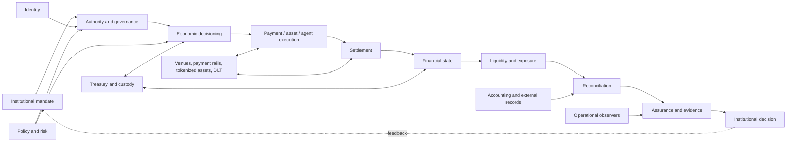

# Institutional Digital Finance Architecture

> A reference architecture for controlling programmable financial systems across authority, economic decisioning, execution, settlement, liquidity, financial state, reconciliation, and assurance.

Modern financial infrastructure is becoming programmable, tokenized, multi-venue, multi-ledger, API-driven, and increasingly autonomous. The difficult problem is not simply transaction execution. It is institutional control across the complete economic lifecycle.

This repository proposes an **executable reference architecture** and connects it to independent implementations, experiments, and an experimental open specification. The references are not technically integrated with one another. No claim of production deployment, institutional adoption, or industry-standard status is made.

## Architectural thesis

Authorization is only one part of institutional control. An institution must also decide whether an action is economically justified, observe what executed and settled, account for the resulting financial state, manage liquidity and exposure, reconcile records, and retain evidence that supports an institutional decision.

## Read the architecture

- [Reference architecture](architecture/reference-architecture.md) — lifecycle boundaries, components, and design principles.
- [Authority and governance](architecture/authority-and-governance.md) · [Economic decisioning](architecture/economic-decisioning.md)
- [Execution and settlement](architecture/execution-and-settlement.md) · [Financial state](architecture/financial-state.md)
- [Liquidity and exposure](architecture/liquidity-and-exposure.md) · [Reconciliation](architecture/reconciliation.md) · [Assurance and evidence](architecture/assurance-and-evidence.md)
- [Failure taxonomy](failure-modes/control-failure-taxonomy.md) · [Control-plane matrix](references/architecture-matrix.md)
- [Existing work and selection rationale](references/existing-work.md)

## Institutional workflows

1. [Tokenized-asset treasury](workflows/tokenized-asset-treasury.md)
2. [Stablecoin payment](workflows/stablecoin-payment.md)
3. [Institutional delivery-versus-payment](workflows/institutional-dvp.md)
4. [Agentic financial action](workflows/agentic-financial-action.md)

## Operationalization

The architecture is a synthesis and reference model. The linked repositories remain separate systems; their adjacency does not imply an integration. Maturity varies from tested executable reference implementations to limited simulations and experimental specifications. Review [existing-work.md](references/existing-work.md) and each source repository's limitations before interpreting its claims.

## Scope and status

This is an independent, evolving reference architecture for institutional digital assets, tokenization infrastructure, programmable finance, digital money, stablecoin and DvP settlement, treasury, ALM, liquidity risk, financial state, reconciliation, assurance, agentic finance, and distributed systems. OMST is described as an experimental/open reference specification, not an adopted industry standard. Canton references describe repository artifacts, not a vendor endorsement or verified production deployment.

## Contributing

Proposed changes should clarify control ownership, state transitions, failure behavior, evidence boundaries, or traceability to an executable artifact. Use synthetic examples and label conceptual components explicitly.
